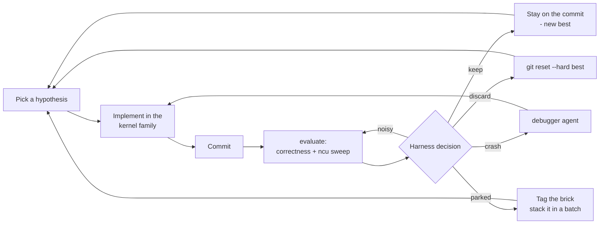

On an edge GPU, LLM serving lives or dies in one place: the decode-attention kernel. Every generated token re-reads the whole KV cache, so on a Jetson, decode speed is a memory problem — and improving the kernel that solves it is a grind of *hypothesis → implement → measure → keep or revert*, hundreds of times over. That loop is perfect agentic work. [Mjolnir](https://github.com/GoBrrr-ai/mjolnir), the community serving stack behind a dedicated decode kernel for Jetson AGX Thor and AGX Orin, ships its research loop as a first-class feature: **autoresearch**.

Autoresearch follows [karpathy/autoresearch](https://github.com/karpathy/autoresearch): agents change one file, a fixed harness scores the change, the change is kept only if the score improves — and **every experiment lands on the ledger**, kept, discarded or crashed. You write the research program; the agents grind it while you sleep.

This tutorial runs the loop on real hardware with the model it was built around, [Qwen3.8 27B](/models/qwen3-8-27b/), and ends with the part most agent demos skip: what the loop actually produced, crashes and all.

## The rules of the game

The entire trick is a contract that leaves the agent no room to fool itself:

| # | Rule | Why it matters |
|---|---|---|
| 1 | **One playground.** Agents change only the kernel family — `src/mjolnir/mjolnir/arch/<platform>/` (the CuTe DSL kernel, its builder, constants, plan, harness). | A small, reviewable diff per idea; the vLLM side only ever follows a *kept, human-merged* win. |
| 2 | **One score.** `mjolnir autoresearch evaluate` runs 13 correctness cases against a bit-faithful emulator, then an ncu sweep of FlashInfer vs Mjolnir at 8 context lengths (128 → 256K tokens). Score = geomean of the per-length speedups, reference and candidate measured **in the same run**. | Drift on a shared GPU cancels out; one context length cannot fake a win. |
| 3 | **The harness decides, never the model.** keep / noisy / parked / discard / crash — each with the reason printed. | The LLM proposes; the measurement disposes. |
| 4 | **Everything on the ledger.** One JSONL row per experiment: hypothesis, sources, per-length numbers, paths to the raw results. | Discarded ideas are the next person's head start. |
| 5 | **Humans gate the release.** A kept win becomes a normal pull request, raw results attached. | The agent never pushes; you ship. |



<div class="admonition note">
<p class="admonition-title">📘 The decision is computed, not hallucinated</p>
<p>A <b>keep</b> needs correctness, a geomean gain over 2%, a gain that survives dropping its best context (<i>one great length is not a win</i>), and at most one length slower than the ±3% noise band. <b>Parked</b> rows are real-looking wins under the bar: tagged <code>ar/parked/&lt;sha&gt;</code>, never the reference — but two or three parked bricks stack into a batch that clears the bar. <b>Noisy</b> means the measurement was rejected, not the idea: re-evaluate the same commit.</p>
</div>

## Prerequisites

- **Jetson AGX Thor** (JetPack 7.x) for the full program — or **Jetson AGX Orin** (JetPack 7.2.1+), where the loop runs against the `feat/orin` kernel branch
- Docker + NVIDIA Container Toolkit, and [`uv`](https://docs.astral.sh/uv/)
- [OpenCode](https://opencode.ai) (`npm i -g opencode-ai`) with any model provider configured
- ~30 minutes of setup, an evening of attention, and a power outlet — the loop is designed to run unattended

## Step 1: prepare the board

```bash
git clone https://github.com/GoBrrr-ai/mjolnir && cd mjolnir
uv tool install mjolnir-cli     # the CLI; the package is mjolnir-cli, the command is mjolnir

mjolnir hw setup                # one-time: clocks, power mode, fans - stable numbers
mjolnir image                   # pull the narandill/mjolnir-vllm image
mjolnir serve up                # serve the default config: Qwen3.8-27B, MJOLNIR backend
mjolnir bench e2e               # prove the baseline: official image vs Mjolnir, decode/prefill/TTFT/ITL
```

The loop shares the GPU with that serving container.

<div class="admonition warning">
<p class="admonition-title">⚠️ Shared-GPU etiquette is a hard rule</p>
<p>The agent may never stop, restart, or kill the serving container or any container it did not start. The harness waits for a clean window by itself — if <code>evaluate</code> waits, let it wait. This rule is in the program the agent reads; resist the urge to "help" by restarting things mid-run.</p>
</div>

## Step 2: read the research program

[`research/program.md`](https://github.com/GoBrrr-ai/mjolnir/blob/main/research/program.md) is the human-editable research org: the current baseline, the constraints, the loop, the batching rules, and a field guide to the per-length split (short contexts are launch-bound, long ones bandwidth-bound — a change that wins one end and loses the other gets gated, not merged). The orchestrator agent follows it to the letter. **Edit it to steer the research**: tighten the constraints, add ideas, mark experiments as negative.

The orchestrator ships with the repo (`.opencode/agent/autoresearch.md`). Four helpers are optional ids it delegates to — `arxiv-researcher`, `web-researcher`, `python-engineer`, `debugger` — define them in `~/.config/opencode/agent/` with your model and prompts. Missing ones are fine: the orchestrator does those steps itself.

## Step 3: open a run

```bash
mjolnir autoresearch init myfirst     # branch autoresearch/myfirst + the baseline row
mjolnir autoresearch run              # opencode run --agent autoresearch ... until you stop it
# or pick the orchestrator's brain:
mjolnir autoresearch run --model anthropic/claude-opus-5-5
```

Inside an interactive OpenCode session, `/autoresearch` resumes the loop.

One iteration, as the agent lives it: read state (`git log`, `autoresearch status`, `ledger --tail 15`) → pick a hypothesis, optionally delegating to the literature agents (each returns arXiv ids / URLs that land in the ledger's `sources`) → delegate the implementation to `python-engineer`, one idea per commit → `mjolnir autoresearch evaluate -m "<hypothesis>" --agent <who>` (10–20 minutes: correctness, then the sweep) → read the **per-length line**, not just the geomean → act on the decision.

A real ledger row, abridged:

```json
{"id": 7, "status": "discard", "score": 1.4183, "best_before": 1.4102,
 "reason": "geomean +0.6% <= +2% (set aside, reference jumped: 256K)",
 "hypothesis": "fuse the split-KV merge into the last CTA per sequence (--merge_fused)",
 "sources": ["arXiv:2405.10480"], "agent": "python-engineer",
 "verify_runs": {"correctness": "...", "sweep": "..."}}
```

Every number in it re-plots from the raw `mjolnir verify` results — experiments never touch the headline charts (`default: false`).

## Step 4: read the morning

```bash
mjolnir autoresearch status             # best score, counts per status
mjolnir autoresearch ledger --tail 40   # every experiment, newest last
mjolnir autoresearch export             # research/runs/<tag>/ - ledger + SUMMARY.md, commit-ready
```

The re-rendered `progress.png` tells the whole night in one image: every experiment's score, the kept ones as a running-best staircase, crashes as ×, and the per-length split under it. Read per length before choosing the next idea — the split says *where* a change works, and the ledger's crash rows say what not to try twice.

<div class="admonition tip">
<p class="admonition-title">✅ Costs and sanity</p>
<p>An evaluation is 10–20 minutes of GPU and a modest number of tokens; a night is a handful of experiments. Pin a cheaper orchestrator with <code>--model</code> if the bill matters, and check <code>autoresearch status</code> over coffee, not at 3 a.m. Each run re-baselines itself — never compare a score to last week's number by hand.</p>
</div>

## Step 5: land a win

A kept experiment is still just a commit until a human ships it:

```bash
git checkout -b my-win main
git cherry-pick <kept commit>            # or: a batch of parked bricks
mjolnir verify bench                     # the full public benchmark, on the record
uv run mjolnir plot --readme             # regenerate docs, charts, README from raw data
git push && open a PR with research/runs/<tag>/ attached
```

Ledgers of discarded ideas are welcome in PRs too — they tell the next person, human or agent, what not to try.

## What the loop produced so far

| run | board | experiments | outcome |
|---|---|---|---|
| `run1` | Thor | 12 (7 crash · 4 discard) | no keep — the crashes hardened the harness rules |
| `oct21` | Thor | 6 (1 parked) | no keep; a parked brick banked for a future batch |
| `oct28` | Orin | 6 (**1 keep**) | first kept win: the M-tile dispatch package, harness score 0.84× → 1.19× |

That last row is the honest texture of agentic research: most rows are lessons, and the win looks small in the ledger and large in the product. The shipped kernel — grown by this loop and by hand — now stands, measured against the same-run FlashInfer reference at every context from 128 to 256K tokens:

| | Jetson AGX Thor | Jetson AGX Orin |
|---|---|---|
| Kernel vs FlashInfer (geomean) | **1.21×** (2.17× vs FA4 hd256) | **1.13×** |
| Decode, end-to-end (1 req) | 21.7 → **36.4 tok/s** (+68%) | 18.2 → **24.3 tok/s** (+34%) |
| Prefill 8K / TTFT 8K | **+78%** / **−18%** | ~par / ~par |
| Inter-token latency | **−35 to −42%** | **−19 to −27%** |

On the [Qwen3.8 27B model page](/models/qwen3-8-27b/) you will find NVIDIA's published numbers for the same chip (vLLM MTP 25.9 tok/s on Thor, 14.0 on Orin at 1 request). Different harness, different prompts — treat the official figures and Mjolnir's same-run A/B as two lenses on the same hardware, and rerun both with `mjolnir bench e2e` before believing any delta. The 6-bit `e2m3` KV cache also fits **~31% more tokens** of context in the same memory, with tool-calling accuracy within ±3.6 points of the stock fp8 baseline.

## Steal the pattern

Nothing in the loop is kernel-specific. The recipe survives contact with any problem that has a cheap, decisive score:

1. **Pick a playground one directory wide** — a kernel family, a quantization config, a sampling pipeline.
2. **Freeze the harness** and forbid the agent from touching it; the score must mean the same thing all night.
3. **Same-run comparisons only** — candidate and reference in one invocation, so shared-GPU drift cancels.
4. **The harness decides, with printed reasons**; sub-noise wins get *parked* (and batched), never promoted on vibes.
5. **Ledger everything**, raw data linked; **humans gate the release**.

Mjolnir's configs-as-code make the A/B one command (`mjolnir bench ab --backends A,B`), and the program file keeps the agent's marching orders in `git` where they belong. Point the same skeleton at your own artifact and let it run.

## Next steps

- Try the result: [Mjolnir on the Community Projects page](/projects/) and the [Qwen3.8 27B model page](/models/qwen3-8-27b/)
- Set up the rest of the agentic toolchain: [AI-assisted development on Jetson](/tutorials/ai-assisted-development-on-jetson/) and [Jetson Agent Skills](/tutorials/jetson-agent-skills/)
- Read the loop's source: the [research program](https://github.com/GoBrrr-ai/mjolnir/blob/main/research/program.md), the [kernel case studies](https://github.com/GoBrrr-ai/mjolnir/tree/main/docs/platforms), and [karpathy/autoresearch](https://github.com/karpathy/autoresearch)

<p>
<a href="https://github.com/GoBrrr-ai/mjolnir" class="nv-button">Mjolnir on GitHub →</a>
</p>
